<h1 align="center">Hey, I'm DrummingBird1 👋</h1>

<b>I build private, local-first tools: Chrome extensions, Android apps and small web apps.</b>

  
  
  
  
  
  
  
  
  

  

## 🛠 What I work on

| Project | What it is |
| --- | --- |
| [**GoW PSP Recomp**](https://github.com/DrummingBird1/gow-psp-recomp)  | Unofficial native PC ports of God of War: Chains of Olympus and Ghost of Sparta (PSP) by static recompilation. Bring your own disc. |
| [**Tzafir (RedAlert)**](https://github.com/DrummingBird1/RedAlert) | Real-time Israeli Home Front Command alerts on an interactive map, in 14 languages. [Live demo](https://red-alert-ten.vercel.app) |
| [**NoveLauncher**](https://github.com/DrummingBird1/NoveLauncher) | A private, on-device Android launcher with Hebrew (RTL) support, smart search and Jewish calendar. |
| [**PhoneLab**](https://github.com/DrummingBird1/PhoneLab) | Real-time Android sensor monitor, benchmark and thermal alerts, plus a browser dashboard. |
| [**TimeTrack**](https://github.com/DrummingBird1/timetrack-extension) | Privacy-first, local-first Chrome extension that tracks your active browsing time. |
| [**PS Store Enhancer**](https://github.com/DrummingBird1/ps-store-enhancer) | Chrome extension: price history and cross-platform prices for the PlayStation Store. |
| [**GOG Enhancer**](https://github.com/DrummingBird1/GOGEnhancer) | Unofficial helper for gog.com: currency conversion, price history, tags and wishlist alerts. |
| [**Steam Enhancer**](https://github.com/DrummingBird1/steam-enhancer) | Chrome extension for Steam: price history, wishlist tools, market and inventory helpers. |
| [**Nova Homepage**](https://github.com/DrummingBird1/nova-privacy) | A private new-tab page for Chrome. No accounts, no tracking, no servers. |
| [**PortHub**](https://github.com/DrummingBird1/PortHub) | Install, update and launch native PC ports of classic console games, safely. Bring your own ROM. |

## 💡 How I like to build

- **Local-first and private:** your data stays on your device, with no accounts and no tracking.
- **Open about the plan:** most projects have a `ROADMAP.md` that shows what shipped and what is next.
- **Tested and reviewed:** changes go through pull requests and CI, with security scanning turned on.
- **Hebrew and English:** interfaces with full right-to-left support.

## 👑 GitHub Trophies

  

The trophies are rendered daily by a GitHub Action in this repository. The streak card above is drawn by a public third-party service and can be slow or empty at times.

## ☕ Support my work

If one of these tools is useful to you, you can support its development:

## 🤝 Get in touch

Found a bug or have an idea? Open an issue in the project's repository. I'm open to suggestions and collaboration.
